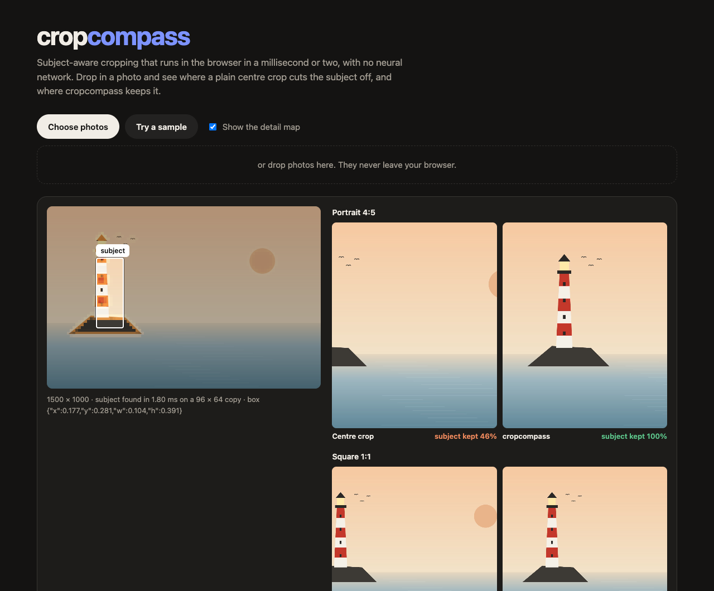
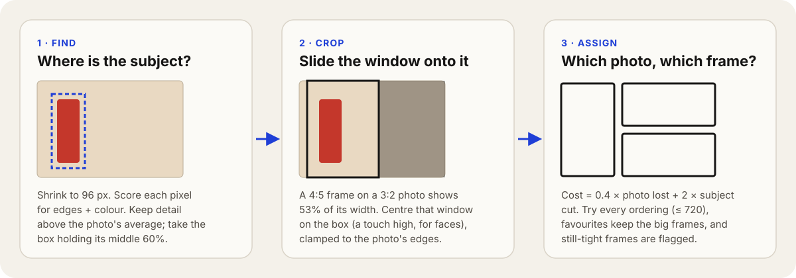

# cropcompass

**Subject-aware cropping for photo layouts, with no neural network and no dependencies.**
It finds where the subject of a photo is, slides each frame's crop onto it, and gives every photo the frame shape it suits. It runs in the browser in a millisecond or two per photo.

**[Try the live demo →](https://arrox1627.github.io/cropcompass/demo/)** Drop in your own photos; they never leave your browser.



Built for photo-book layouts, where a template pours dozens of photos into fixed frames of different shapes. With a plain centre crop, the person standing on the left of a landscape photo ends up cut out of the portrait frame they land in. cropcompass keeps them in.

| On 1,000 synthetic photos, 5,750 photo-and-frame pairs | Centre crop | **cropcompass** |
| --- | ---: | ---: |
| Subject kept, on average | 85.1% | **99.5%** |
| Subject kept whole | 55.5% | **95.6%** |
| Time to find the subject (96 px copy, Node 24) | | **0.14 ms** |

<sub>Run `npm run bench` to reproduce. The scenes have one clear subject on a plain background, so this is a best case for both methods. See [Limits](#limits) for where real photos are harder.</sub>

---

## Why not just use AI?

A face or object detector would also work. For this job, it isn't the right trade:

- **It's free and instant.** No model to download, no GPU, no server round-trip. The subject is found when the photo is added, on the customer's own phone, in about a millisecond.
- **It's private.** Photos never leave the browser to be analysed.
- **It's predictable.** Every step is a few lines of arithmetic you can read, test and tune, and it fails gently. With nothing to aim at, it falls back to a slightly-high centre crop, which is what a person would do.
- **"Good enough" is the bar.** A photo book frame needs the interesting part in view, not a pixel-perfect mask. Edges and colour find it in the vast majority of travel, family and event photos.

## How it works



### 1 · Find the subject (`src/focus.js`)

1. **Shrink** the photo to 96 px on its long edge. Detail that matters at book size survives, and the maths is about 6,000 pixels instead of 12 million.
2. **Score every pixel** for *detail*:
   - **Edges:** the luminance gradient magnitude (central differences), the same signal edge detectors start from. People, faces, text, buildings and objects are full of edges. Sky, walls, floors and fog are not.
   - **Colour:** plus `0.25 × saturation` (max − min channel), because subjects tend to be more colourful than backgrounds.
3. **Keep only what stands out.** Each pixel's score minus the photo's *own* average, floored at zero. This one line is what makes it robust: an evenly busy photo (a forest, a crowd) has nothing above its average and stays centred, rather than being dragged to whichever corner is busiest.
4. **Centre prior.** Detail is gently discounted towards the edges, `× (1 − 0.125·(dx² + dy²))`, because photographers rarely put the subject on the very edge.
5. **Project and trim.** The remaining detail is summed into a column profile and a row profile. On each axis the box spans from the 20th to the 80th percentile of that mass, the densest 60%. That's a robust box that a few stray edges can't stretch.
6. **Know when to give up.** If almost nothing stands out (a misty lake, a plain wall), it returns the whole photo and the crop falls back to its default.

The output is a box in fractions of the photo, for example `{ x: 0.18, y: 0.28, w: 0.10, h: 0.39 }`, small enough to store with the photo.

### 2 · Place the crop (`cropFor`)

A frame of aspect *a* on a photo of aspect *p* shows a window of `a/p` of the width (if the photo is wider) or `p/a` of the height (if it's taller). cropcompass slides that window so it's centred on the subject box, clamped so it never runs off the photo. Vertically it aims **45% of the way down the box rather than 50%**, because faces, heads and horizons sit high in a frame. With no box, it leans slightly upwards (42% down) for the same reason. The result is a CSS `object-position`, so it drops straight into `object-fit: cover`.

### 3 · Give each photo the frame it suits (`arrange`)

A page with three frames (one tall, two wide) and three photos (two landscape, one portrait) has six ways to fill it, and most are wrong. Every photo-in-frame pairing gets a cost:

```
cost = 0.4 × (share of the photo the frame's shape throws away)
     + 2.0 × (share of the subject the best crop still has to cut)
```

Throwing away background is cheap. Cutting into the subject is five times more expensive. Every ordering is tried (at most 6! = 720 for six frames, which is instant), and the cheapest wins. Starred favourites are guaranteed the largest frames. Any frame that still cuts more than 18% of its subject is flagged `check`, so the product can ask a person to take a look rather than silently printing a bad crop.

The same cost can drive bigger decisions too: switching a page to another layout with the same number of photos, or swapping a badly-fitting photo with one on the facing page, but only when it's clearly better, so a book's planned rhythm survives.

## Use case: a family trip to Rajasthan

> Priya gets back from ten days in Rajasthan with 340 photos on her phone. She opens a photo-book app, picks a travel template for a 60-page portrait book, and uploads 120 favourites. She stars eight of them.

**Without cropcompass:** the pages fill in seconds, and they look wrong. Her daughter, standing on the left edge of a wide shot of Hawa Mahal, is cut out of the tall frame she lands in. The sunset over the Thar has its sun cropped away and lots of empty sand. A portrait photo of the family on a camel goes into a wide frame and loses everyone's heads. Fixing 120 photos by hand on a phone takes an hour, and most people give up and order it as it is, or don't order at all.

**With cropcompass:**

1. **As each photo uploads**, her phone measures its subject box on a 96 px copy (about a millisecond, invisible) and saves it with the photo.
2. **When the pages are made**, the tall photo of the camel goes into the tall frame and the wide Hawa Mahal shot into a wide one. Her starred photos take the largest frames.
3. **Each crop slides onto its subject:** her daughter on the left stays in the frame, and the sunset keeps its sun.
4. **Two frames are still tight** (a group photo where nine people won't fit a square), so the editor marks them with a small "check the framing" note. She drags one, swaps the other, and orders.

**For the business:** fewer customers drop off at the editing stage, fewer reprints and complaints about cut-off heads, and no per-photo AI bill. **For Priya:** the book looks like someone designed it.

The same approach fits anywhere photos meet fixed frames: e-commerce thumbnails, social media cards, CMS hero images, real-estate listings and event galleries.

## Use it

```js
import { focusOfImage, cropFor, arrange } from './src/index.js';

// 1. When a photo is added (in the browser): find its subject once and keep it.
const focus = focusOfImage(imgElement);          // { x, y, w, h } as fractions
const photo = { aspect: img.naturalWidth / img.naturalHeight, focus };

// 2. Crop it for any frame shape: a CSS object-position.
const crop = cropFor(photo, 4 / 5);               // { x: 0.12, y: 0.31, zoom: 1 }
imgElement.style.objectFit = 'cover';
imgElement.style.objectPosition = `${crop.x * 100}% ${crop.y * 100}%`;

// 3. Or fill a page: which photo goes in which frame.
const { cells } = arrange(photos, [{ aspect: 0.8, area: 2 }, { aspect: 1.5, area: 1 }, { aspect: 1.5, area: 1 }]);
// cells[i] = { photo, frame, crop, check }
```

In Node or a worker, pass raw RGBA pixels to `focusFrom(data, width, height)`.

| Function | What it does |
| --- | --- |
| `focusFrom(rgba, w, h)` | The subject box from raw pixels (a 96 px copy is plenty) |
| `focusOfImage(img)` | The same, from an ``, `ImageBitmap` or canvas, in the browser |
| `detailMap(rgba, w, h)` | The per-pixel detail scores (0 to 1), for drawing a heatmap |
| `cropFor(photo, frameAspect)` | The crop that best shows the subject, as an `object-position` |
| `cutOf(photo, frameAspect, crop)` | The share of the subject a crop leaves out |
| `isTight(photo, frameAspect, crop)` | Whether a person should check this frame |
| `arrange(photos, frames)` | The best photo-to-frame assignment, cropped and flagged |

## Run it

```bash
npm test          # 19 checks, no dependencies (Node 18+)
npm run bench     # the centre crop vs cropcompass table above
npm run demo      # then open http://localhost:3000/demo/ and drop in your own photos
```

## Limits

Being honest about where a 96-pixel edge detector falls short:

- **Long, sharp straight lines** (a crisp horizon, a railing, a building edge across the whole frame) count as detail everywhere along them, and can widen the box. Real horizons are usually soft enough not to matter, but a hard one can pull the crop off-centre.
- **It doesn't know what a face is.** A plain-shirted person against a busy market will lose to the market. That's the case a face detector would win, and why the `check` flag exists.
- **A small subject on a busy background** (a bird in leaves) has nothing standing out, so it stays centred.
- **The middle 60%** of detail is deliberately conservative: the box hugs the densest part, so very tall subjects can lose their top, like a lighthouse's lamp, in the tightest frames.

Possible next steps: an optional face detector (the browser's `FaceDetector` where available) feeding the same box, a line detector to discount long straight edges, and per-template weights learned from the crops people make by hand.

## Project layout

```
src/focus.js      stage 1: the subject box
src/crop.js       stages 2 and 3: crops, costs, assignment
src/index.js      exports
demo/index.html   interactive demo (drop photos, see centre crop vs cropcompass)
test/             tests, synthetic scenes and the benchmark
docs/             the pipeline diagram and the demo screenshot
```

## Licence

MIT © 2026 Arnav Naahar
